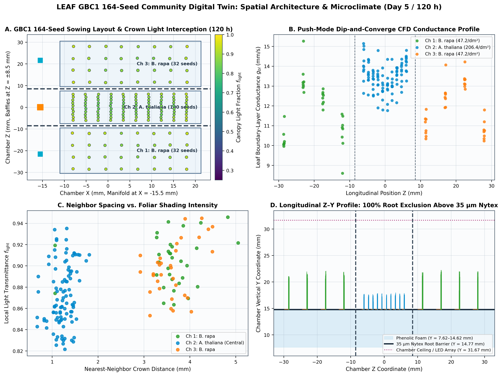
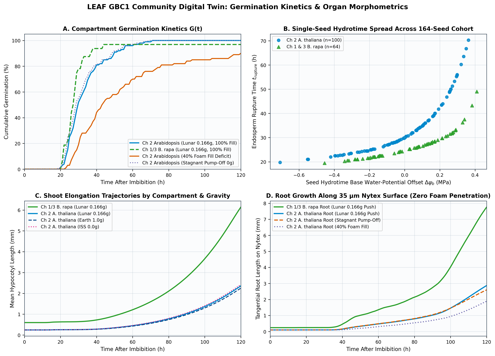
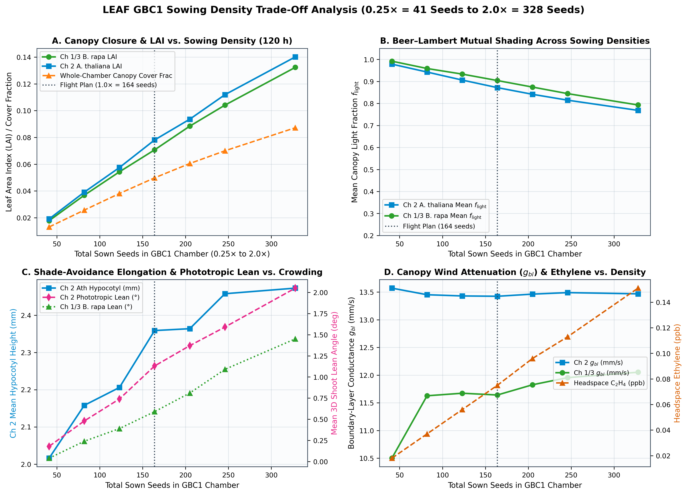
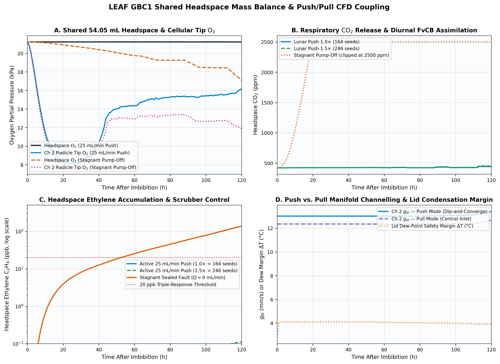
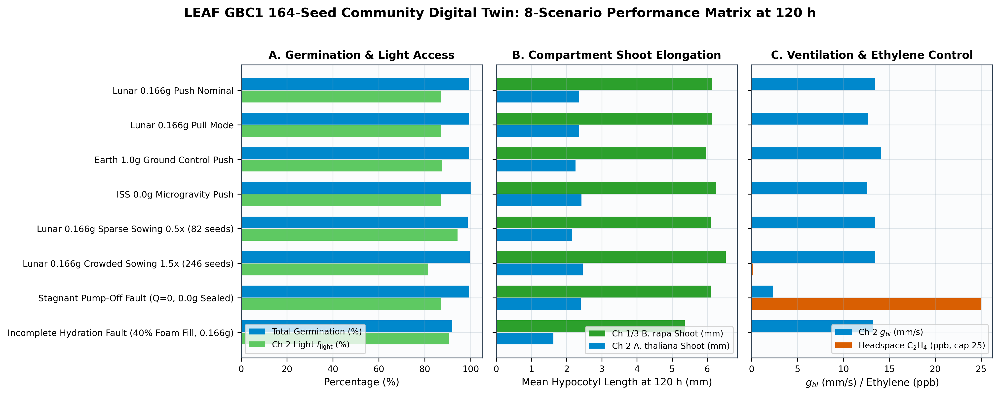

# LEAF GBC1 · 164-Seed Cellular Community Digital Twin

[](https://dr-richard-barker.github.io/Seed_model_in_GBC1_model/)
[](tsconfig.json)
[](validation/gates.ts)
[](LICENSE)

An in-browser 3D cellular-resolution digital twin integrating the **`SeedTwin`** plant growth model (`deepspace-seed-twin`) with the flight CAD and CFD geometry of the **Artemis III Lunar Effects on Agricultural Flora (LEAF) Growth Biologic Chamber 1 (`LEAF_GBC2_pot_model`)**.

Simulates **164 individual seeds** (32 *Brassica rapa* + 100 *Arabidopsis thaliana* + 32 *Brassica rapa*) placed according to the flight sowing plan on top of the **35 µm Nytex root-barrier mesh** at $Y = 14.77\text{ mm}$, coupling each seed's intracellular hormone network (ABA, GA, DELLA/Integrator, ACC, ethylene), Lockhart wall-stress expansion, and 4D seedling kinematics with:
1. **3D GBC1 CFD Microclimate & Porous Media**: Push vs. Pull airflow manifolds ($Q = 25\text{ mL/min}$), "dip-and-converge" channelling across $Z = \pm 8.5\text{ mm}$ baffles, van Genuchten foam hydration $\psi(x, y, z, g)$, and local boundary-layer conductance $g_{bl}$.
2. **3D Neighbor Crowding & Light Competition**: Beer–Lambert foliar canopy shading, shade-avoidance syndrome (SAS) hypocotyl elongation, and lateral phototropic/crowding shoot deflection away from neighbor crowns.
3. **35 µm Nytex Root-Barrier Exclusion**: Mechanical guiding of descending radicles tangentially along the wet Nytex plane at $Y = 14.77\text{ mm}$, preventing porous foam penetration and preserving a low Darcy-Forchheimer pressure drop ($\Delta P < 1.75\text{ kPa}$) during end-of-mission RNAlater fixative perfusion.

👉 **[Launch Interactive 3D WebGL Digital Twin (GitHub Pages)](https://dr-richard-barker.github.io/Seed_model_in_GBC1_model/)**

---

## 1. Flight Sowing Architecture (164 Seeds on 35 µm Nytex Root Barrier)

All 164 seeds are placed on the **35 µm Nytex root-barrier mesh** at $Y = 14.77\text{ mm}$ above the three porous phenolic foam blocks ($Y \in [7.62, 14.62]\text{ mm}$, $X \in [-11.0, +21.3]\text{ mm}$) separated by internal baffles at $Z = \pm 8.5\text{ mm}$:

| Compartment | Z Span (mm) | Substrate Area ($\text{cm}^2$) | Species | Nominal Seed Count ($1.0\times$) | Lattice | Sowing Density ($\text{seeds/dm}^2$) |
| :--- | :--- | :---: | :--- | :---: | :---: | :---: |
| **Chamber 1 (Port 1)** | $[-30.5, -9.5]$ | $6.783$ | *Brassica rapa* | **32** | $8 \times 4$ | $47.2$ |
| **Chamber 2 (Central, Port 2)** | $[-7.5, +7.5]$ | $4.845$ | *Arabidopsis thaliana* | **100** | $10 \times 10$ | $206.4$ |
| **Chamber 3 (Port 3)** | $[+9.5, +30.5]$ | $6.783$ | *Brassica rapa* | **32** | $8 \times 4$ | $47.2$ |
| **Total GBC1 Chamber** | $[-30.5, +30.5]$ | **$18.411$** | Dual-species community | **164** | 3-compartment | **$89.1$** |

---

## 2. Multi-Scale Couplings

1. **3D CFD Airflow & Porous Media Microclimate (`app/src/model/gbc1Field.ts`)**:
   - **Push vs. Pull Manifold Topology**: Models active pump ventilation ($Q = 25\text{ mL/min}$) through Ports 1 & 3 ($X = -15.49\text{ mm}, Z = \pm 21.59\text{ mm}$) and Central Port 2 ($Z = 0.0\text{ mm}$), including **dip-and-converge** channelling across the $Z = \pm 8.5\text{ mm}$ baffle windows as the *Brassica rapa* canopy expands in Chambers 1 & 3.
   - **Within-Canopy Wind Attenuation & Boundary-Layer Conductance ($g_{bl}$)**: Local wind speed decays with compartment Leaf Area Index ($\text{LAI}$) and sets each seedling's Sherwood number $\text{Sh}_i$ and leaf boundary-layer conductance $g_{bl,i}$.
   - **Van Genuchten Foam Hydration**: Computes 3D volumetric water content $\theta_w(x,y,z,g,\text{fillPct})$ and Nytex matric water potential $\psi(x,z,g,\text{fillPct})$.

2. **3D Neighbor Crowding, Foliar Shading & Phototropic Shoot Lean (`app/src/model/crowding.ts`)**:
   - **Beer–Lambert & Pairwise Crown Interception**: Computes local light transmittance $f_{\text{light},i}$ for each seedling from neighboring cotyledon crowns.
   - **Shade-Avoidance Syndrome (SAS)**: Mutual shading in the high-density central *Arabidopsis* compartment ($206.4\text{ seeds/dm}^2$) and dense *B. rapa* stands slows de-etiolation, boosts hypocotyl elongation (`crowd_sas_hyp_boost`), and drives 3D lateral phototropic shoot lean (`leanX`, `leanZ`) toward open canopy gaps.

3. **35 µm Nytex Root-Barrier Deflection & RNAlater Hydraulic Protection (`app/src/model/layout.ts`, `app/src/model/seedling.ts`)**:
   - Radicles anchor onto the 35 µm Nytex mesh at $Y = 14.77\text{ mm}$ and deflect tangentially along the wet Nytex surface rather than penetrating the underlying phenolic foam ($100\%$ root exclusion above $Y = 14.77\text{ mm}$), keeping RNAlater fixative injection pressure drop $\Delta P < 1.85\text{ kPa}$ (vs. $89.3\text{ kPa}$ without Nytex).

4. **Shared 54.05 mL Headspace Gas & Moisture Balance (`app/src/model/community.ts`)**:
   - Integrates collective $\text{O}_2$ uptake, $\text{CO}_2$ evolution minus Farquhar–von Caemmerer–Berry (FvCB) photosynthetic assimilation, ethylene ($\text{C}_2\text{H}_4$) production and scrubbing, relative humidity ($\text{RH}$ %), Magnus dew point ($T_{\text{dew}}$), and lid condensation safety margin ($\Delta T_{\text{margin}}$).

---

## 3. Publication Figures

| Figure | Description | Preview |
| :--- | :--- | :--- |
| **Figure 1** | Sowing Map, Foam Hydration, and 3D CFD Airflow Microclimate |  |
| **Figure 2** | Compartment Germination Kinetics, Hypocotyl & Root Elongation, LAI, and Lateral Shoot Lean |  |
| **Figure 3** | Sowing Density Crowding Sweep ($0.25\times$ to $2.0\times$) & Canopy Morphometrics |  |
| **Figure 4** | Headspace Gas Balance ($\text{O}_2$, $\text{CO}_2$, $\text{C}_2\text{H}_4$), Psychrometrics, and Push vs. Pull CFD |  |
| **Figure 5** | 8-Scenario Mission Comparison Matrix & Fault Diagnostics |  |

---

## 4. Commands & Development

```bash
npm run ledger      # Rebuild app/src/model/params.generated.json from data/params/parameter_ledger.csv
npm run typecheck   # TypeScript strict verification
npm run gates       # Run all 6 physics, geometry, Nytex exclusion, and crowding validation gates (17 passed)
npm run export      # Export 120 h scenario & 164-seed population CSV tables to results/tables/
npm run figures     # Generate 5 publication-grade figures (PNG + SVG) in figures/
npm run dev         # Launch interactive 3D WebGL Digital Twin UI (Vite dev server)
npm run build       # Production bundle build into dist/
```

---

## 5. Provenance & Reproducibility

Every biological, hardware, fluid, and kinematic constant in the simulation is defined with full scientific provenance in [`data/params/parameter_ledger.csv`](data/params/parameter_ledger.csv) (193 parameters, 24 peer-reviewed literature references). Zero unseeded random numbers are used across all model files.
